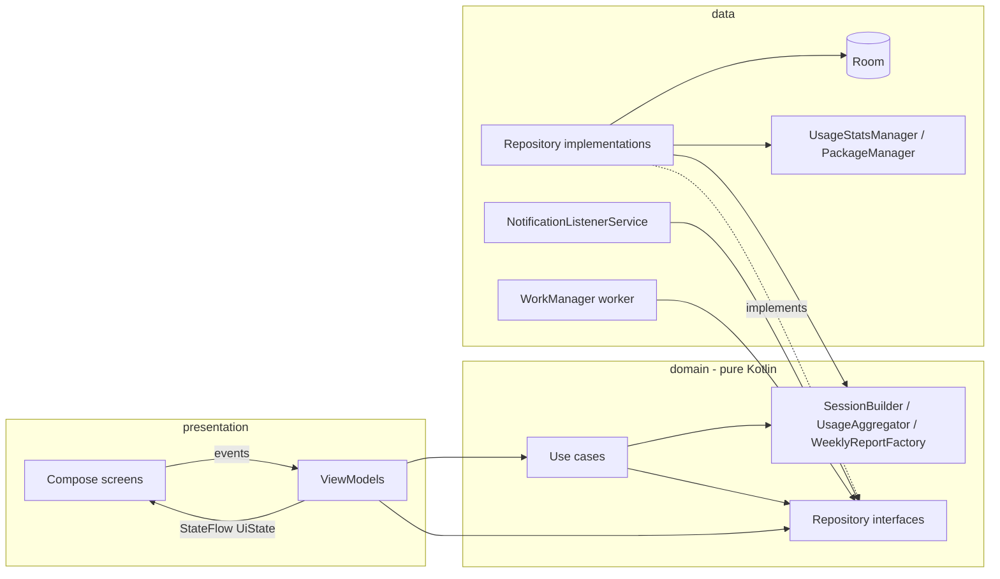

# Activity Report

An Android app that answers one question: **"What did I do on my phone this week?"**

It records how long each app was on screen, how often apps were opened, how many times the
phone was unlocked, how many notifications arrived, and which apps were installed or removed.
It presents this as a Monday-to-Sunday report that can be compared with the week before.

Technical test submission: *Activity Report App*.

---

## 1. How I read the brief

The brief asks for a solution that is comprehensive, efficient and/or practical. On
Android you cannot have all three, so I chose in this order:

1. **Practical:** one permission, no account, works on any phone.
2. **Efficient:** data is collected in the background a couple of times a day, with no
   permanent service.
3. **Comprehensive:** only where Android offers an official, privacy-friendly source.

That is why the app does not try to read ads or game scores: it would need to watch the
screen of other apps, which I do not think a user should have to accept.

## 2. What is in the report, and what is not

| Data from the brief | Decision | Source and reasoning |
|---|---|---|
| Time spent per app | **Built** | `UsageStatsManager.queryEvents()`, paired resume/pause events |
| How often apps are opened | **Built** | Same events: one session = one launch |
| Apps installed / removed | **Built** | No history API exists; the app diffs the launchable-app list between syncs |
| Notifications received | **Built, opt-in** | `NotificationListenerService`; only a counter per app and day is stored |
| Phone unlocks (my addition) | **Built** | Keyguard events in the same stream, at no extra cost |
| Total video watched | **Estimate** | Time spent in apps that declare the *video* category. Labelled as an estimate in the UI |
| Game high scores | **Not built** | Scores live inside each game's sandbox or its own Play Games account; no other app can read them |
| Most-seen advertised product | **Not built** | Would require reading the screen or the network traffic of other apps. I consider that unacceptable for a wellbeing tool |

## 3. Trade-offs

**One mandatory permission.** *Usage access* gives time, launches and unlocks. Notification
access is offered later, as an option, with an explanation. The app is useful without it.

**Everything stays on the device.** The manifest has no `INTERNET` permission and cloud
backup is disabled, so the data cannot leave the phone. This removes the need for an account,
a backend, a privacy policy for uploaded data, and GDPR processing of behavioural data.

**Own event pairing instead of the system's aggregated buckets.** `queryUsageStats()` is
simpler, but its buckets do not follow the user's local midnight or week and contain no
launch count. Pairing raw events gives exact per-day figures and lets me define a "launch"
sensibly (moving between two screens of one app is not two launches).

**Daily aggregates, not raw sessions, in the database.** The report needs per-day, per-app
totals. Storing one row per app per day keeps the database tiny and the queries trivial.
The price: session-level statistics (for example "longest session") are not available.

**Periodic background sync instead of a foreground service.** Android keeps detailed usage
events only for a limited time, so they must be copied regularly. A 12-hourly WorkManager
job (plus a sync whenever the app is opened) does this with no permanent notification and
lets the system batch the work. Each sync continues from the last day that has data and
recalculates that whole day, so running it twice gives the same result.

**Honest about limits.** History starts with whatever the system still holds at first
launch. Removal dates are "detected at next sync", not exact. The video figure is an
estimate. The UI and this README say so.

## 4. Architecture

MVVM with Clean Architecture, unidirectional data flow, single activity.



```
app/src/main/java/com/nk/activityreportapp
├── ActivityReportApplication   Hilt entry point, schedules the background sync
├── MainActivity                single activity hosting the Compose UI
├── domain          no Android imports
│   ├── model       WeeklyReport, AppUsage, UsageEvent, Highlight ...
│   ├── logic       SessionBuilder, UsageAggregator, WeeklyReportFactory, WeekCalculator
│   ├── repository  ActivityRepository, PermissionRepository (interfaces)
│   └── usecase     GetWeeklyReport, GetAppDetail
├── data
│   ├── datasource  UsageStatsDataSource, InstalledAppsDataSource
│   ├── local       Room entities, DAOs, database
│   ├── repository  ActivityRepositoryImpl, PermissionRepositoryImpl
│   ├── notification NotificationCounterService
│   └── worker      UsageSyncWorker, UsageSyncScheduler
├── presentation
│   ├── navigation  Navigation 3 routes and root composable
│   ├── viewmodel   MainViewModel, ActivityViewModel, AppDetailViewModel
│   └── ui          Onboarding, report and app-detail screens, components
├── di              Hilt modules
└── ui/theme        Material 3 theme
```

**Dependency rule.** `presentation` and `data` depend on `domain`; `domain` depends on
nothing. Use cases exist only where they add logic (combining flows, shaping data); a
simple call such as "sync now" or "is access granted" goes straight to the repository
interface.

The rule is kept by package convention inside one Gradle module, which is the right size
for this app. Splitting into `:domain`, `:data` and `:app` modules would let the compiler
enforce it and is the first step I would take if the app grew.

**Data flow.**

1. `UsageSyncWorker` (every 12 h) or the report screen (on open / refresh) calls
   `ActivityRepository.sync()`.
2. The repository reads system events from the last recorded day onwards, `SessionBuilder`
   turns them into sessions, `UsageAggregator` splits them per local day, and the result
   is upserted into Room.
3. Room exposes `Flow`s. `GetWeeklyReportUseCase` combines usage, unlocks, notifications and
   app changes and hands them to the pure `WeeklyReportFactory`.
4. `ActivityViewModel` exposes one `StateFlow<ActivityUiState>`; the screen collects it with
   `collectAsStateWithLifecycle()` and sends user actions back as function calls.

Because the UI observes the database, a background sync or a new notification updates an
open report without any extra code.

**Coroutines.**

- Reads are cold `Flow`s, writes are `suspend` functions.
- `flatMapLatest` on the selected week cancels the previous query when the user changes week.
- `stateIn(WhileSubscribed(5_000))` keeps the query alive across rotation and stops it when the UI is gone.
- A `Mutex` makes sure the worker and the UI never sync at the same time.
- The IO dispatcher and the `Clock` are injected, so tests control threads and time.

## 5. Tech stack

| Area | Choice |
|---|---|
| Language / build | Kotlin 2.2, AGP 9.1 (built-in Kotlin), Gradle 9.3, version catalog, KSP |
| UI | Jetpack Compose (BOM 2026.02.01), Material 3, dynamic colour, edge-to-edge |
| Navigation | Navigation 3 |
| DI | Hilt (with assisted injection for navigation arguments, `@HiltWorker`) |
| Persistence | Room |
| Background | WorkManager |
| Async | Coroutines and Flow |
| Tests | JUnit 4, kotlinx-coroutines-test, hand-written fake repositories |
| CI | GitHub Actions: unit tests and debug build |

`minSdk 29`: the activity-level usage events and keyguard events the report relies on are
only complete from Android 10.

No chart library: the app needs one bar chart, built from standard layout composables so it
follows the theme and is read correctly by TalkBack.

## 6. Tests

```
./gradlew testDebugUnitTest
```

| Test | What it proves |
|---|---|
| `SessionBuilderTest` | Event pairing: single session, same-app screens merged within the gap, separate visits beyond it, app switches, screen off, session still open at the end of the window |
| `UsageAggregatorTest` | A session across midnight is split and its launch counted once, sessions of one app are added up, unlocks are counted per day |
| `WeeklyReportFactoryTest` | Week boundaries, totals, ranking, previous-week comparison, highlights, notifications, empty week |
| `GetWeeklyReportUseCaseTest` | Repository data is combined into a report, including the week before for the comparison |
| `GetAppDetailUseCaseTest` | Usage and notifications are gathered for one app; the package name is used when no data exists |
| `ActivityViewModelTest` | Initial state, week navigation, sync, report loading |
| `AppDetailViewModelTest` | Loading state, then the app detail once data is available |
| `MainViewModelTest` | Permission state is read from the repository and refreshed |

The logic that is easy to get wrong is pure Kotlin and tested on the JVM. Not covered yet:
DAO tests on an in-memory database and Compose UI tests (see next steps).

## 7. Run it

1. Clone the repository:
   ```
   git clone https://github.com/nibeditakalo/ActivityReportApp.git
   ```
2. Open the project in a recent Android Studio and let Gradle sync.
3. Run the `app` configuration on a device or emulator with Android 10 or later.
4. Tap **Open usage access settings**, enable *Activity Report*, and go back.
5. Optional: tap **Enable** on the notifications card to count notifications.

An emulator has little usage history; use a few apps first, then tap refresh.

## 8. Known limitations

- The first report is partial: only the events the system still holds at first launch.
- If the phone stays off, or the app is force-stopped for longer than the system keeps
  events, that period is lost.
- App installs and removals are dated at the sync that noticed them, and are reported
  from the second sync onwards (the first one only records the starting list).
- Each sync reads events from 00:00 of the day it continues from. An app that was already
  open at that midnight is counted only from the next time it comes to the foreground.
- The notification count includes updates to an existing notification and ongoing ones
  (music, navigation), so it runs a little high.
- Split-screen and picture-in-picture: only the app that most recently came to the
  foreground is counted.
- Video time counts whole apps that declare the video category. A browser playing video is
  not counted, and browsing a video app's menus is.
- Some manufacturers restrict background work; the sync on app open covers that case.

## 9. What I would do next

- DAO tests, Compose UI tests and screenshot tests.
- Export the report as an image or PDF to share.
- French and Dutch translations (all UI text is already in `strings.xml`).
- Split into Gradle modules and add a baseline profile.
